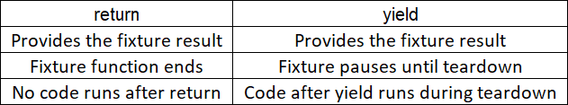

Today's learning objectives
By the end of Day 18, you should understand:
1. Fixture dependencies.
2. Setup and teardown.
3. The yield keyword in fixtures.
4. Fixture scope in practice.
5. Automatic fixtures using autouse=True.
6. How to organize reusable test data.



Use return when you only need to provide data.

Use yield when you need cleanup after the test.

**Lesson 1:**  **Fixture dependencies.**

The Idea: Sometimes, you need to build one LEGO piece before you can attach another piece on top of it. In pytest, one fixture can ask for another fixture to do its job first!


**Lesson 2 & 3:** **Setup, Teardown & Why yield?**

The Idea: Imagine setting up a tea party (Setup), playing the tea party (The Test), and washing the cups afterward (Teardown).
• return is like handing someone a cup of tea and walking away forever—you never come back to clean up.
• yield is like saying, "Here is the cup. I will pause right here while you drink it. When you are done, I will wake up and clean the cup!"


**Lesson 4: Autouse & Fixture Scope (How Often Do We Reset?)**

• autouse=True: Normally, a test only gets a fixture if it asks for it by name. autouse=True is like a ninja—it runs automatically for every test without being asked!
• Fixture Scope: This controls how often the setup runs:
	• scope="function" (Default): Runs fresh for every single test (like washing your plate after every meal).
	• scope="module": Runs only once for the entire Python file (like setting up a dining table once for the whole day).


# Day 18: Pytest Fixture Dependencies and Setup/Teardown

## Learning goals

Today focused on how pytest fixtures can depend on other fixtures,
prepare resources before a test, and clean up after a test.

## 1. Fixture dependencies

A fixture can request another fixture by adding its name as a function
parameter.

``` python
import pytest

@pytest.fixture
def valid_patient():
    return Patient(1001, "Aaron", 38, "Knee Replacement")

@pytest.fixture
def validated_patient(valid_patient):
    PatientValidator.validate(valid_patient)
    return valid_patient

def test_patient_details(validated_patient):
    assert validated_patient.patient_id == 1001
    assert validated_patient.name == "Aaron"
```

Pytest creates `valid_patient` first, then passes it to
`validated_patient`. The test requests only `validated_patient`, but
both fixtures run.

**Important:** A `Patient` instance is an object, not a dictionary. Use
dot notation such as `patient.name` and `patient.patient_id`. Do not use
dictionary-style assignment such as `patient["is_valid"] = True` unless
the object supports it.

If validation returns `True` or raises an exception, there is no need to
add an `is_valid` field to the patient object just to show that
validation passed.

## 2. `return` versus `yield` in fixtures

-   Use `return` when the fixture only needs to create and provide a
    value.
-   Use `yield` when the fixture must run cleanup code after a test.

``` python
@pytest.fixture
def patient_folder(tmp_path):
    folder = tmp_path / "patient_1001"
    folder.mkdir()

    yield folder

    print("Teardown: test has finished")
```

Code before `yield` is setup. The yielded value is passed to the test.
Code after `yield` is teardown and runs after the test finishes,
including when the test fails.

## 3. Fixture dependencies for file setup

A fixture can depend on a fixture that creates a folder.

``` python
import json
import pytest

@pytest.fixture
def patient_folder(tmp_path):
    folder = tmp_path / "patient_1001"
    folder.mkdir()
    yield folder

@pytest.fixture
def patient_json_file(patient_folder):
    file_path = patient_folder / "patient.json"
    data = {"id": 1001, "name": "Alice"}

    file_path.write_text(json.dumps(data))
    yield file_path

def test_patient_json(patient_json_file):
    assert patient_json_file.exists()

    content = json.loads(patient_json_file.read_text())
    assert content["name"] == "Alice"
```

When `test_patient_json` requests `patient_json_file`, pytest follows
the dependency chain:

1.  `tmp_path` provides a temporary directory.
2.  `patient_folder` creates the patient folder.
3.  `patient_json_file` creates the JSON file.
4.  The test checks the file and its contents.
5.  Teardown code after each `yield` runs in reverse dependency order.

A fixture does not run just because it exists. It runs when a test or
another fixture requests it. A test that requests only `patient_folder`
will not run `patient_json_file`.

## 4. The `tmp_path` fixture

`tmp_path` is a built-in pytest fixture. It gives each test a temporary
directory for file and folder operations.

It is useful for tests that create or read JSON files, text reports,
patient case folders, and temporary CAD output files.

Use `tmp_path` instead of writing test files into real project folders.
Pytest manages the temporary directory lifecycle.

## 5. Showing setup and teardown messages

Use `-s` to display `print()` output while pytest runs.

``` powershell
python -m pytest tests/test_fixtures.py -v -s -p no:cacheprovider
```

Replace `test_fixtures.py` with the actual test file name.

-   `-v`: shows each test name and result.
-   `-s`: shows print output.
-   `-p no:cacheprovider`: disables pytest's cache plugin.

Use `python -m pytest` so the active Python environment runs pytest.

## 6. Key debugging lesson

An error such as:

``` text
TypeError: 'Patient' object does not support item assignment
```

means the code is treating a `Patient` object like a dictionary. Check
the type of the value and use the access style that matches it:

``` python
patient.name             # object attribute
patient["name"]          # dictionary key, only for dictionaries
```

Also distinguish between:

-   **Setup error:** pytest could not prepare a fixture, so the test
    body did not start.
-   **Assertion failure:** the test body ran, but an assertion was not
    true.

## 7. Day 18 practical exercises

-   [x] Create a fixture that returns a valid patient.
-   [x] Create a fixture that depends on the valid-patient fixture and
    validates the patient.
-   [x] Use patient attributes with dot notation.
-   [x] Create a patient folder using `tmp_path`.
-   [x] Create a JSON file inside the folder using a dependent fixture.
-   [x] Check that the file exists and read its JSON content.
-   [x] Understand that only requested fixtures run.
-   [x] Understand that code after `yield` runs during teardown.

*Tick the items above only if you completed and ran the corresponding
exercise.*

## 8. Main takeaways

1.  Fixtures can depend on other fixtures.
2.  Pytest resolves fixture dependencies before running the test.
3.  `return` provides a value; `yield` can provide a value and support
    teardown.
4.  Teardown code runs after the test, even if the test fails.
5.  `tmp_path` gives tests a safe temporary workspace.
6.  A fixture runs only when something requests it.
7.  Use object attributes for class instances and dictionary keys for
    dictionaries.
8.  A setup error is different from a failed test assertion.

## Day 18 status

**Topic:** Pytest fixture dependencies, setup/teardown, and temporary
file handling.

**Status:** Learning and exercises covered in the session. Confirm the
full test run before marking the day complete.

